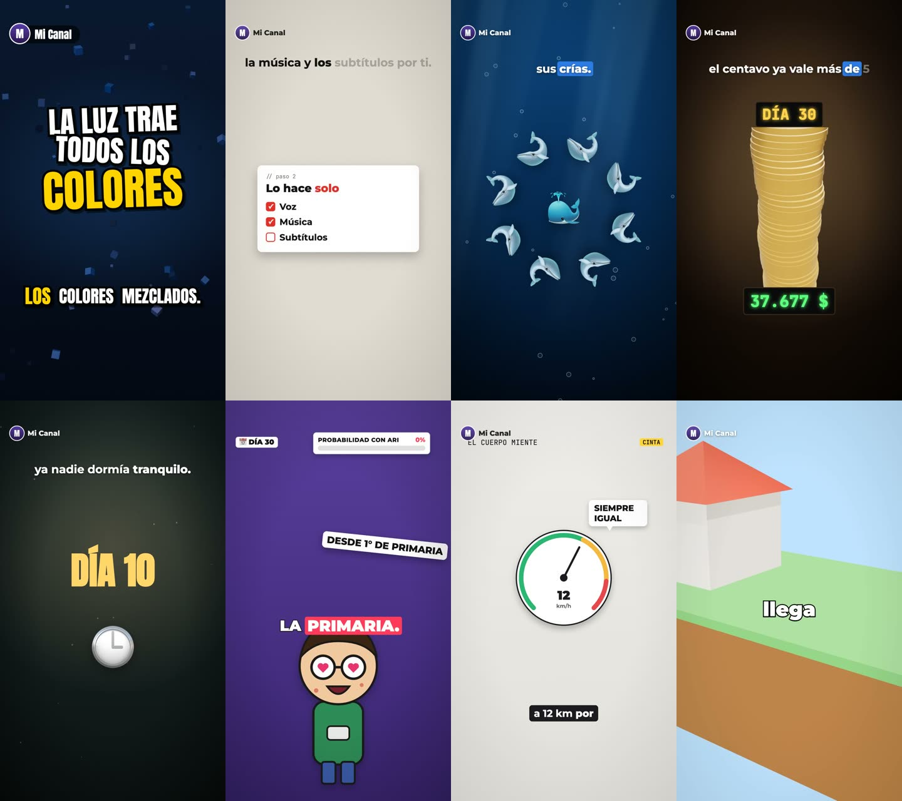

# Morfeo

**Videos verticales animados desde código.** Escribes las escenas; Morfeo pone la voz, la música, los efectos,
los subtítulos, las animaciones y la miniatura. Para YouTube Shorts, TikTok y Reels.

**📖 Documentación: [ureckchan.github.io/morfeo](https://ureckchan.github.io/morfeo/)**



<sub>De izquierda a derecha y de arriba abajo: `datos-curiosos`, `explicativo`, `documental`, `mesa`, `historia`, `serie`, `infografia`, `3d`. Todos salieron de los [ejemplos](ejemplos/guiones).</sub>

## Qué hace

- **10 estilos**, y puedes crear los tuyos:
  - datos curiosos, tutoriales y documentales;
  - historias de misterio;
  - objetos 3D sobre una mesa;
  - series con personaje y "¡comenta!";
  - infografías;
  - escenas 3D de Blender con recorrido de cámara.
- **Motor de capas:** imágenes, texto, contadores, tarjetas, teléfonos, medidores, votaciones, noticieros, chats,
  personajes con poses, modelos 3D y tus propios componentes de React. Todo aparece justo en la palabra que dice la voz.
- **Voces:**
  - Kokoro, gratis y en tu computadora, con más de 50 voces y mezclas;
  - ElevenLabs u OpenAI con tu cuenta;
  - tu propia grabación, o cualquier servicio que conectes.
- **Música:** 7 estilos generados sin derechos de autor, o tu propia pista. Baja sola cuando habla la voz.
- **Guiones e imágenes con IA:** `npx morfeo guion "tema"` escribe el video completo con Claude, y
  `generar: 'un oso pardo'` dibuja con IA. Todo queda en caché para no pagar dos veces.
- **Subtítulos:** karaoke, en bloque, palabra por palabra o estilo TikTok. Con Whisper quedan sincronizados con la voz.

## Empezar

Necesitas Node.js 18 o más nuevo.

```bash
npx morfeo nuevo mi-canal
cd mi-canal
npm install
npx morfeo instalar
npx morfeo render
```

`npx morfeo instalar` se corre una sola vez por computadora:

- busca Python y, si falta, ofrece instalarlo;
- descarga las voces (~340 MB) y el navegador de render;
- pregunta si quieres Whisper para subtítulos exactos.

`npx morfeo doctor` te dice qué falta.

## Un video

```js
// guiones/cachalote.mjs
export default {
	estilo: 'documental',
	voice: 'em_alex',
	music: 'ballad',
	scenes: [
		{say: '¿Sabías que las orcas le tienen miedo a un solo animal?', capas: [
			{tipo: 'imagen', src: 'cachalote.png', ancho: 700, entrada: 'deslizar-der', flotar: true},
			{tipo: 'chip', texto: '×5', x: 760, y: 1260, en: 'animal', sonido: 'pop'},
		]},
		{type: 'dato', say: 'Baja a más de dos mil metros.', show: 'Baja a más de 2.000 metros.', valor: 2000, sufijo: ' m'},
		{type: 'cta'},
	],
};
```

```bash
npx morfeo render cachalote
```

## Más

- **[Documentación](https://ureckchan.github.io/morfeo/):** estilos, escenas, capas, animaciones, HUD, personajes, 3D, voces, música, guiones y la API para usarlo desde código.
- **[Ejemplos](ejemplos):** los 8 videos de la galería, listos para renderizar. Entra a `ejemplos/`, corre `npm install` y luego `npx morfeo render`.
- **¿Algo falla o tienes una idea?** [Abre un issue](../../issues/new/choose).

## Comandos

| Comando | Qué hace |
|---|---|
| `morfeo nuevo <carpeta>` | Crea un proyecto con videos de ejemplo |
| `morfeo instalar` / `doctor` | Prepara o revisa la computadora |
| `morfeo lista` | Videos del proyecto y cuáles ya están hechos |
| `morfeo render [id...]` | Genera los que faltan (`--todos`, `--gpu`) |
| `morfeo studio` | Editor en el navegador para ver y ajustar en vivo |
| `morfeo guion "tema"` | Claude escribe un video (`--estilo serie`, `--imagenes`, `--desde guion.txt`) |
| `morfeo estilos` | Lista los estilos visuales |

## Licencia

Puedes usar Morfeo gratis para crear videos, incluidos los comerciales, y los videos son tuyos. El código de Morfeo es
propiedad de Uriel Gómez: no se permite copiarlo, modificarlo ni redistribuirlo. Remotion tiene su propia licencia:
es gratis para personas y equipos de hasta 3 personas. Detalles en [LICENSE](LICENSE).
